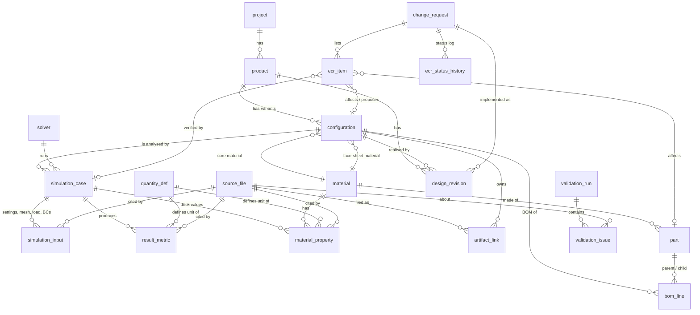

# Database schema

SQLite, created from [`plm/schema.sql`](../plm/schema.sql) by `python -m plm init`. Foreign keys are enforced
(`PRAGMA foreign_keys = ON` on every connection made by `plm.db.connect`).

**Design rule.** Constraints guarantee *structural* integrity: primary/foreign keys, `UNIQUE`, `NOT NULL` on identifiers, enumerations
via `CHECK ... IN (...)`. Physical validity (thickness > 0, E > 0, canonical units, ...) is **not** a `CHECK`: as-received data must
be storable so that `plm/checks.py` can *report* it with a severity and a suggested correction instead of the import failing.

**Provenance columns.** `origin` (`solver_file` / `documented` / `derived`) and `basis` (`source` / `demonstration`) say where a row
comes from. Source and derived values are never mixed in one column: percent changes and the stiffness proxy are computed by the
queries in `sql/`, not stored.

## Relationships

## Tables

| Table | Purpose | Keys and constraints |
|---|---|---|
| `quantity_def` | Dictionary of every stored quantity: canonical unit, dimension, whether it is a core result | PK `quantity`; referenced by `result_metric.metric_name`, `material_property.quantity` |
| `project`, `product` | Project and product information (title and objective come from the README) | PK; `product.project_id` FK; `UNIQUE(name)`, `UNIQUE(product_code)` |
| `material` | Materials (PLA, ePA-CF) | PK; `UNIQUE(name COLLATE NOCASE)` |
| `material_property` | Material data with its origin: the value given to the solver (`origin='solver_file'`, `case_id` set) and the value printed in the report (`origin='documented'`, `case_id` NULL). Keeps `original_value`/`original_unit` | FKs to `material`, `simulation_case`, `quantity_def`, `source_file`; `UNIQUE(material_id, quantity, origin, source_file_id, locator)` |
| `configuration` | A design configuration of the product: face-sheet thickness plus core and face-sheet material | PK; FKs to `product`, `material` (x2); `UNIQUE(config_code)` (e.g. `T085`) |
| `part`, `bom_line` | **Demonstration** part numbers and BOM per configuration (`bom_line.config_id`), parent/child with quantity | `part`: `UNIQUE(part_number COLLATE NOCASE)`; `bom_line`: FKs to `configuration`/`part`, `CHECK(parent <> child)`, `UNIQUE(config_id, parent, child)` |
| `design_revision` | **Demonstration** design revisions: revision label to configuration, optional ECR, optional superseded revision | `UNIQUE(product_id, rev_label)`; self-FK `supersedes_rev_id` |
| `change_request`, `ecr_item`, `ecr_status_history` | **Demonstration** engineering change request: reason, status (`DRAFT` ... `VERIFIED`/`CLOSED`/`REJECTED`), affected/proposed parts and configurations, verification simulation cases, ordered status log | `ecr_item`: `CHECK` that exactly one of `part_id`/`config_id`/`case_id` is set, role in (`affected`,`proposed`,`verification`); `ecr_status_history`: `UNIQUE(ecr_id, seq)` |
| `solver` | Solver name/version/build (ANSYS MAPDL 2025 R1, build 25.1) | `UNIQUE(name, version)` |
| `simulation_case` | One analysis of one configuration with one solver; run time as printed in `solve.out` (no time zone is recorded there) and project save time in UTC | FKs to `configuration`, `solver`; `UNIQUE(case_code)` |
| `simulation_input` | Analysis settings, mesh counts, load, boundary conditions, material assignment. `origin='derived'` rows carry the `derivation` formula | FKs to `simulation_case`, `source_file`; `UNIQUE(case_id, param_name, origin, source_file_id, locator)` |
| `result_metric` | Result values in canonical units, with `original_value`, `original_unit` and `printed_text` exactly as read; `status='missing'` + `missing_reason` for values that are not available | FKs to `simulation_case`, `quantity_def`, `source_file`; `UNIQUE(case_id, metric_name, statistic, component, source_file_id, locator)` |
| `source_file` | Every repository file and every member of every `.wbpz`, with SHA-256 and size | `UNIQUE(rel_path, archive_member)`; index on `sha256` |
| `artifact_link` | Which files belong to which configuration/case and in which role (`solver_input_deck`, `solver_log`, `contour_image:equivalent_stress`, ...) | FKs to `source_file`, `configuration`, `simulation_case`; `UNIQUE(source_file_id, config_id, role)` |
| `validation_run`, `validation_issue` | Results of `python -m plm validate`: check code, severity, affected record, message, suggested correction | FKs; `severity` in (`error`,`warning`,`info`) |

View `v_result_primary`: one value per (case, metric, statistic, component), preferring the full-precision report value over the
rounded README value. Queries and checks use it so that README and report are never double counted.

## Indexes

The main join columns are indexed (`ix_case_config`, `ix_result_case_metric`, `ix_input_case`, `ix_link_config`, `ix_link_case`,
`ix_bom_config`, `ix_bom_parent`, `ix_bom_child`, `ix_ecr_item_ecr`, `ix_revision_config`, `ix_issue_run`, ...), the provenance columns
(`ix_result_source`, `ix_input_source`, `ix_matprop_source`: "which values came from this file?") and `ix_source_file_sha` for
duplicate-content detection. The `UNIQUE` constraints create the indexes for the natural keys. Foreign keys of tiny lookup tables
(e.g. `part.material_id`) are not indexed.

## Where each kind of data comes from

| Data | Source in the repository | How it is read |
|---|---|---|
| Configurations (thickness) | `Simulation Files (ANSYS)/<t>mm/` folder names; cross-checked against the README table, report Table 6 and the solver mass | folder name regex |
| Solver, run time, mesh counts, mass, warnings | `solve.out` inside each `.wbpz` | `plm.ingest.parse_solve_out` |
| Material cards, element-to-material map, load, fixed support, load area | `ds.dat` (MAPDL input deck) and `MatML.xml` (material names) | `parse_ds`, `parse_matml` |
| Max displacement component | `file.mntr` | `parse_mntr` |
| Project save time (UTC) | `.wbpj` | `parse_wbpj` |
| Deformation, stress, strain (documented) | README results table; report Table 6 (transcribed in `data/report_values.csv`, page-referenced, machine-checked against the PDF) | `parse_readme`, CSV import |
| Report material table, report load, report table labels | report pp. 37, 46 (`data/report_values.csv`) | CSV import |
| BOM | `data/demo_bom.csv` (**demonstration**) | `plm.workflow.import_demo_bom` |
