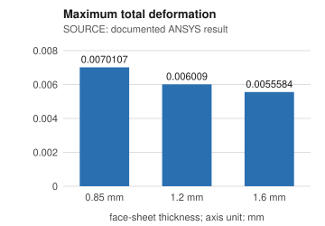
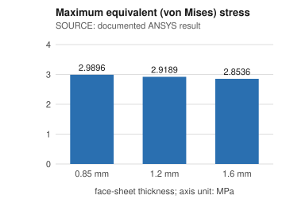
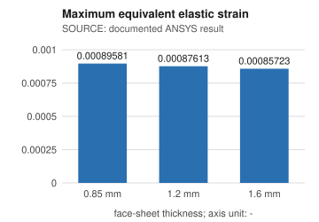
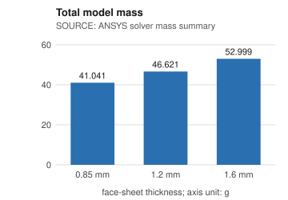
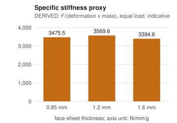

# Engineering data report: honeycomb sandwich panel

Generated from the SQLite database built from this repository. **Three kinds of data are kept apart:**

* **SOURCE** - values imported unchanged from repository files (README, report PDF, ANSYS archives), each traceable to a file and locator.
* **DERIVED** - calculated by the queries from source values (percent changes, stiffness proxy). They are labelled and never stored as results.
* **DEMONSTRATION** - illustrative BOM, revisions and change request created by `python -m plm demo`. Not records of a real PLM system, and nothing was approved by any organisation.

## Dataset overview

| item | count |
|---|---|
| configurations | 3 |
| simulation cases | 3 |
| source files registered | 98 |
| result values | 33 |
| results marked missing | 9 |
| solver inputs / BCs | 61 |

Data-quality run: 0 error(s), 11 warning(s), 14 information item(s); see `data_quality_report.md`.

## Deformation, stress and strain by face-sheet thickness

SOURCE values (documented ANSYS results) with DERIVED percent changes versus the thinnest face sheet.

| config_code | thickness_mm | deformation_mm | stress_mpa | strain | deformation_change_pct_vs_baseline | stress_change_pct_vs_baseline | strain_change_pct_vs_baseline |
|---|---|---|---|---|---|---|---|
| T085 | 0.85 | 0.0070107 | 2.9896 | 0.00089581 | 0 | 0 | 0 |
| T120 | 1.2 | 0.006009 | 2.9189 | 0.00087613 | -14.29 | -2.36 | -2.2 |
| T160 | 1.6 | 0.0055584 | 2.8536 | 0.00085723 | -20.72 | -4.55 | -4.31 |

_Query: `sql/01_compare_thickness_configs.sql`; full output: `query_outputs/01_compare_thickness_configs.csv`._

## Ranking of configurations by engineering metric

Rank 1 = best for that metric. **DERIVED** columns: stiffness and specific stiffness. Rank-1 configuration per metric - lowest deformation: T160; lowest stress: T160; lowest strain: T160; lightest: T085; highest specific stiffness: T120. Different metrics can pick different winners, so 'optimal' depends on the objective.

| config_code | thickness_mm | deformation_mm | stress_mpa | strain | mass_g | stiffness_n_per_mm | specific_stiffness_n_per_mm_per_g | rank_lowest_deformation | rank_lowest_stress | rank_lowest_strain | rank_lightest | rank_highest_specific_stiffness |
|---|---|---|---|---|---|---|---|---|---|---|---|---|
| T160 | 1.6 | 0.0055584 | 2.8536 | 0.00085723 | 52.999 | 179908 | 3394.55 | 1 | 1 | 1 | 3 | 3 |
| T120 | 1.2 | 0.006009 | 2.9189 | 0.00087613 | 46.621 | 166417 | 3569.57 | 2 | 2 | 2 | 2 | 1 |
| T085 | 0.85 | 0.0070107 | 2.9896 | 0.00089581 | 41.041 | 142639 | 3475.53 | 3 | 3 | 3 | 1 | 2 |

_Query: `sql/02_rank_configurations.sql`; full output: `query_outputs/02_rank_configurations.csv`._

## Available results by solver and material

| solver | analysis_type | core_material | face_sheet_material | cases | configurations | metrics_available | metrics_missing | min_deformation_mm | max_deformation_mm | min_stress_mpa | max_stress_mpa |
|---|---|---|---|---|---|---|---|---|---|---|---|
| ANSYS MAPDL 2025 R1 | STATIC (STEADY-STATE) | PLA | ePA-CF | 3 | 3 | 24 | 9 | 0.0055584 | 0.0070107 | 2.8536 | 2.9896 |

_Query: `sql/03_summary_by_solver_material.sql`; full output: `query_outputs/03_summary_by_solver_material.csv`._

## Missing data

Values that exist only in the binary result file or as contour images are marked missing, never estimated.

| record | item | availability | value | unit | reason |
|---|---|---|---|---|---|
| SIM-T085 | directional_deformation | MISSING |  | mm | no machine-readable numeric value in the repository; it exists only in the binary result file (not parsed) and as a contour image (Simulation Images/0.85mm/Directional_deformation.png) |
| SIM-T085 | strain_energy | MISSING |  | mJ | no machine-readable numeric value in the repository; it exists only in the binary result file (not parsed) and as a contour image (Simulation Images/0.85mm/Strain Energy.png) |
| SIM-T085 | volume | MISSING |  | mm^3 | no machine-readable numeric value in the repository; it exists only in the binary result file (not parsed) and as a contour image (Simulation Images/0.85mm/Volume.png) |
| SIM-T120 | directional_deformation | MISSING |  | mm | no machine-readable numeric value in the repository; it exists only in the binary result file (not parsed) and as a contour image (Simulation Images/1.2mm/Directional_Deformation.png) |
| SIM-T120 | strain_energy | MISSING |  | mJ | no machine-readable numeric value in the repository; it exists only in the binary result file (not parsed) and as a contour image (Simulation Images/1.2mm/Strain_energy.png) |
| SIM-T120 | volume | MISSING |  | mm^3 | no machine-readable numeric value in the repository; it exists only in the binary result file (not parsed) and as a contour image (Simulation Images/1.2mm/Volume.png) |
| SIM-T160 | directional_deformation | MISSING |  | mm | no machine-readable numeric value in the repository; it exists only in the binary result file (not parsed) and as a contour image (Simulation Images/1.6mm/Directional_deformation.png) |
| SIM-T160 | strain_energy | MISSING |  | mJ | no machine-readable numeric value in the repository; it exists only in the binary result file (not parsed) and as a contour image (Simulation Images/1.6mm/Strain_Energy.png) |
| SIM-T160 | volume | MISSING |  | mm^3 | no machine-readable numeric value in the repository; it exists only in the binary result file (not parsed) and as a contour image (Simulation Images/1.6mm/Volume.png) |

_Query: `sql/04_missing_data.sql`; full output: `query_outputs/04_missing_data.csv`._

## Cross-solver comparison (only genuinely corresponding results)

Only results that exist for the same configuration, analysis type, metric and component in two solvers are compared. The repository contains a single solver, so no cross-solver comparison is possible and the result is empty by design.

_no rows_

_Query: `sql/07_cross_solver_comparison.sql`; full output: `query_outputs/07_cross_solver_comparison.csv`._

## DEMONSTRATION data: BOM, revisions and change request

> Everything in this section is illustrative. Part numbers use the `DEMO-` prefix. The BOM mirrors the three bodies of the ANSYS model; the revisions and the change request are a simulated workflow linked to the real simulation results above.

### Indented BOM per configuration (DEMONSTRATION data)

| config_code | part_number | name | part_type | quantity_per_assembly | material | thickness_mm | basis |
|---|---|---|---|---|---|---|---|
| T085 | DEMO-HSP-1000 | Honeycomb sandwich panel assembly | assembly | 1 |  |  | demonstration |
| T085 |   DEMO-HSP-2000 | Hexagonal honeycomb core | component | 1 | PLA |  | demonstration |
| T085 |   DEMO-HSP-3085 | Face sheet 0.85 mm | component | 2 | ePA-CF | 0.85 | demonstration |
| T120 | DEMO-HSP-1000 | Honeycomb sandwich panel assembly | assembly | 1 |  |  | demonstration |
| T120 |   DEMO-HSP-2000 | Hexagonal honeycomb core | component | 1 | PLA |  | demonstration |
| T120 |   DEMO-HSP-3120 | Face sheet 1.2 mm | component | 2 | ePA-CF | 1.2 | demonstration |
| T160 | DEMO-HSP-1000 | Honeycomb sandwich panel assembly | assembly | 1 |  |  | demonstration |
| T160 |   DEMO-HSP-2000 | Hexagonal honeycomb core | component | 1 | PLA |  | demonstration |
| T160 |   DEMO-HSP-3160 | Face sheet 1.6 mm | component | 2 | ePA-CF | 1.6 | demonstration |

_Query: `sql/09_bom_by_configuration.sql`; full output: `query_outputs/09_bom_by_configuration.csv`._

### Design revisions and their linked simulation cases (DEMONSTRATION data)

| rev_label | basis | supersedes | config_code | thickness_mm | ecr_code | ecr_status | case_code | project_saved_utc | deformation_mm | stress_mpa |
|---|---|---|---|---|---|---|---|---|---|---|
| A | demonstration |  | T085 | 0.85 |  |  | SIM-T085 | 2025-04-29T12:52:48Z | 0.0070107 | 2.9896 |
| B | demonstration | A | T160 | 1.6 | DEMO-ECR-0001 | VERIFIED | SIM-T160 | 2025-04-29T13:31:57Z | 0.0055584 | 2.8536 |

_Query: `sql/06_revision_tracking.sql`; full output: `query_outputs/06_revision_tracking.csv`._

### Engineering change requests, affected items and linked verification results (DEMONSTRATION data)

| ecr_code | status | basis | title | role | item_type | item | note | deformation_mm | stress_mpa |
|---|---|---|---|---|---|---|---|---|---|
| DEMO-ECR-0001 | VERIFIED | demonstration | Increase face-sheet thickness from 0.85 mm to 1.6 mm | affected | configuration | T085 | baseline configuration |  |  |
| DEMO-ECR-0001 | VERIFIED | demonstration | Increase face-sheet thickness from 0.85 mm to 1.6 mm | affected | part | DEMO-HSP-3085 | face sheet being replaced |  |  |
| DEMO-ECR-0001 | VERIFIED | demonstration | Increase face-sheet thickness from 0.85 mm to 1.6 mm | proposed | configuration | T160 | proposed configuration |  |  |
| DEMO-ECR-0001 | VERIFIED | demonstration | Increase face-sheet thickness from 0.85 mm to 1.6 mm | proposed | part | DEMO-HSP-3160 | thicker face sheet |  |  |
| DEMO-ECR-0001 | VERIFIED | demonstration | Increase face-sheet thickness from 0.85 mm to 1.6 mm | verification | simulation_case | SIM-T085 | baseline result for comparison | 0.0070107 | 2.9896 |
| DEMO-ECR-0001 | VERIFIED | demonstration | Increase face-sheet thickness from 0.85 mm to 1.6 mm | verification | simulation_case | SIM-T160 | result of the proposed configuration | 0.0055584 | 2.8536 |

_Query: `sql/10_change_requests.sql`; full output: `query_outputs/10_change_requests.csv`._

### Change-request status history (DEMONSTRATION data)

| ecr_code | seq | from_status | to_status | note |
|---|---|---|---|---|
| DEMO-ECR-0001 | 1 | (created) | DRAFT | created |
| DEMO-ECR-0001 | 2 | DRAFT | SUBMITTED | demonstration step |
| DEMO-ECR-0001 | 3 | SUBMITTED | UNDER_REVIEW | demonstration step (no real reviewer) |
| DEMO-ECR-0001 | 4 | UNDER_REVIEW | IMPLEMENTED | revision B created |
| DEMO-ECR-0001 | 5 | IMPLEMENTED | VERIFIED | verification evidence linked: SIM-T085 and SIM-T160 core results exist (see engineering report for the derived comparison) |

_Query: `sql/11_change_request_history.sql`; full output: `query_outputs/11_change_request_history.csv`._

## Traceability example (configuration T085)

Every value links to its source file, archive member, line/table locator and SHA-256 (first 12 characters shown). `08_traceability.csv` lists all inputs, results and material properties for all configurations.

| item | value | unit | origin | source file | locator | sha256 |
|---|---|---|---|---|---|---|
| equivalent_elastic_strain [assembly] | 0.000896 | 1 | documented | README.md | README.md line 58: row "0.85 mm", column "Elastic Strain" = "0.000896" | 56a573b66abc |
| equivalent_elastic_strain [assembly] | 0.00089581 | 1 | documented | MAJOR PROJECT REPORT (1).pdf | report p.61 Table 6 row 0.85 (transcribed in data/report_values.csv line 3) | 3a80aae3a369 |
| equivalent_stress [assembly] | 2.9896 | MPa | documented | README.md | README.md line 58: row "0.85 mm", column "Von Mises Stress (MPa)" = "2.9896" | 56a573b66abc |
| equivalent_stress [assembly] | 2.9896 | MPa | documented | MAJOR PROJECT REPORT (1).pdf | report p.61 Table 6 row 0.85 (transcribed in data/report_values.csv line 4) | 3a80aae3a369 |
| max_displacement_component [assembly] | -0.0068005 | mm | solver_file | WORKBENCH N MECH.wbpz :: file.mntr | line 11 | a246ea634d37 |
| total_deformation [assembly] | 0.00701 | mm | documented | README.md | README.md line 58: row "0.85 mm", column "Deformation (mm)" = "0.00701" | 56a573b66abc |
| total_deformation [assembly] | 0.0070107 | mm | documented | MAJOR PROJECT REPORT (1).pdf | report p.61 Table 6 row 0.85 (transcribed in data/report_values.csv line 2) | 3a80aae3a369 |
| total_mass [assembly] | 41.041 | g | solver_file | WORKBENCH N MECH.wbpz :: solve.out | line 493 | ed9a991bc759 |

## Limitations

* only one solver (ANSYS MAPDL) is present, so no cross-solver comparison is possible
* all cases share one mesh size (same node/element counts), so mesh sensitivity of the results cannot be assessed
* file.rst / SYS.mechdb are not parsed; stress, strain and deformation are documented values (README, report) cross-checked against the solver monitor and mass, not re-extracted from the result file
* the repository holds no experimental data and no mesh-convergence study; the checks here test internal consistency and comparability only and cannot show that the FEA results are physically correct
